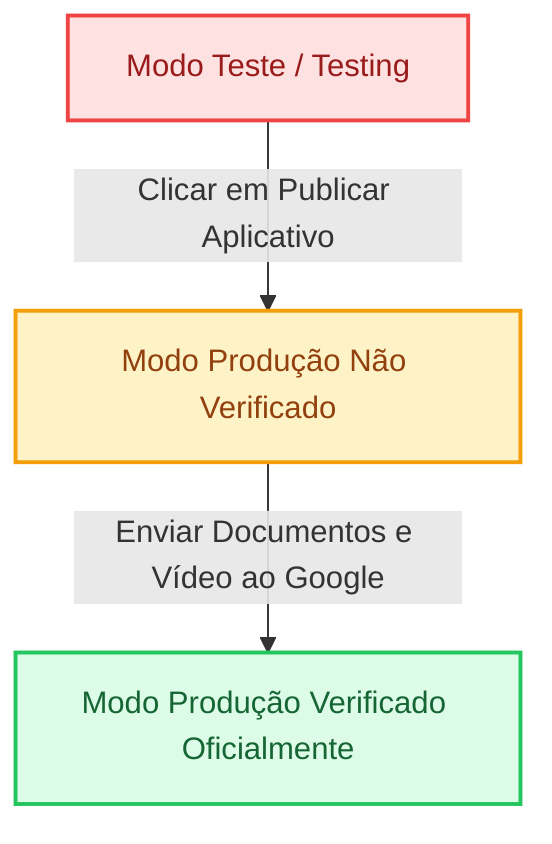

# 🚀 Guia de Configuração em Produção do Google Fotos (Valendo / Modo Público)

Este guia prático e técnico orienta a transição da integração com o **Google Fotos (Google Photos Picker API)** e **Login Social Google** do ambiente restrito de desenvolvimento (*Testing*) para o ambiente definitivo de **Produção ("Valendo")**, permitindo que **qualquer usuário** com conta Google se conecte, autorize e importe suas fotos para o **Ethernity**, sem a limitação de "usuários de teste".

---

## 📌 Sumário Executivo

1. [Por que sair do Modo de Teste?](#1-por-que-sair-do-modo-de-teste)
2. [Quadro Comparativo: Teste vs Produção vs Verificado](#2-quadro-comparativo-teste-vs-produção-vs-verificado)
3. [Passo 1: Ativação Rápida em Produção no Google Cloud (Imediato)](#3-passo-1-ativação-rápida-em-produção-no-google-cloud-imediato)
4. [Passo 2: Configuração de Domínio e URLs Oficiais](#4-passo-2-configuração-de-domínio-e-urls-oficiais)
5. [Passo 3: Credenciais OAuth 2.0 para Produção](#5-passo-3-credenciais-oauth-20-para-produção)
6. [Passo 4: Verificação Oficial do Google (Remover a tela de 'App Não Verificado')](#6-passo-4-verificação-oficial-do-google-remover-a-tela-de-app-não-verificado)
7. [Passo 5: Variáveis de Ambiente no Servidor de Produção](#7-passo-5-variáveis-de-ambiente-no-servidor-de-produção)
8. [Passo 6: Checklist de Teste com Conta Externa Real](#8-passo-6-checklist-de-teste-com-conta-externa-real)
9. [Solução de Problemas em Produção](#9-solução-de-problemas-em-produção)

---

## 1. Por que sair do Modo de Teste?

Durante o desenvolvimento inicial, o Google Cloud Console mantém a aplicação com o status de publicação **"Em teste"** (*Testing*). Este modo tem duas restrições críticas que **inviabilizam o uso real**:

| Problema no Modo Teste | Impacto no Usuário Real | Como o Modo Produção Resolve |
| :--- | :--- | :--- |
| **Limite de 100 Usuários** | Apenas e-mails digitados um a um no GCP conseguem conectar. Qualquer outro usuário recebe `Erro 403: access_denied`. | **Acesso Universal**: Qualquer conta `@gmail.com` ou Google Workspace pode conectar. |
| **Refresh Tokens Expiram em 7 Dias** | Após 7 dias, a chave de atualização expira automaticamente pela política do Google. A conexão cai e o usuário precisa autorizar tudo de novo. | **Tokens Permanentes**: O `refresh_token` não expira após 7 dias, durando até ser revogado ou por inatividade prolongada (6 meses). |
| **Controle Manual no Console** | O administrador precisa cadastrar manualmente amigos, clientes ou testadores. | **Zero Intervenção**: Cadastro e conexão automáticos com um único clique. |

---

## 2. Quadro Comparativo: Teste vs Produção vs Verificado



| Recurso / Característica | 1. Modo Teste (*Testing*) | 2. Produção Não Verificado (*Unverified*) | 3. Produção Verificado (*Verified*) |
| :--- | :--- | :--- | :--- |
| **Quem pode usar?** | Apenas e-mails da lista de teste (máx. 100) | **Qualquer usuário Google do mundo** | **Qualquer usuário Google do mundo** |
| **Validade do Refresh Token** | ⏰ **7 dias apenas** | ♾️ **Indefinido** (permanente) | ♾️ **Indefinido** (permanente) |
| **Tela exibida ao usuário** | Tela normal de consentimento (para quem está na lista) | ⚠️ Alerta amarelo: *"O Google não verificou este app"* (usuário clica em Avançado para entrar) | 🟢 Tela oficial limpa com logotipo do Ethernity sem alertas |
| **Complexidade de ativação** | Nenhuma (padrão) | **1 minuto** (1 clique no Google Cloud Console) | 3 a 5 dias úteis (análise pelo time do Google) |
| **Custo financeiro** | Gratuito ($0) | Gratuito ($0) | Gratuito ($0 para Google Photos Picker API) |

---

## 3. Passo 1: Ativação Rápida em Produção no Google Cloud (Imediato)

Para que **qualquer pessoa** consiga conectar suas fotos reais imediatamente, sem depender da lista de teste:

1. Acesse o **[Google Cloud Console](https://console.cloud.google.com/)**.
2. No menu superior, selecione o projeto do **Ethernity**.
3. No menu lateral esquerdo (☰), navegue até:
   👉 **APIs e Serviços** > **Tela de permissão OAuth** (*OAuth consent screen*).
4. Localize a seção **Status da publicação** (*Publishing status*).
5. Você verá o status atual: `Em teste` (*Testing*).
6. Logo abaixo, clique no botão:
   ```text
   [ Publicar aplicativo ]  /  [ Publish app ]
   ```
7. Uma janela modal de confirmação será exibida:
   - *"Deseja enviar para produção?"* (*Push to production?*)
8. Clique em **Confirmar** (*Confirm*).

> 💡 **Resultado Imediato**: A partir deste segundo, a limitação de usuários de teste está **removida**. Qualquer pessoa com conta Google que acessar o Ethernity conseguirá autorizar o Google Fotos e fazer login.

---

## 4. Passo 2: Configuração de Domínio e URLs Oficiais

No mesmo painel da **Tela de permissão OAuth**, preencha os dados institucionais da aplicação:

### 4.1. Informações Básicas do Aplicativo
- **Nome do app**: `Ethernity`
- **E-mail de suporte do usuário**: Seu e-mail de contato ou suporte (ex: `suporte@ethernity.com.br` ou seu Gmail).
- **Logotipo do app**: Envie o logo oficial do Ethernity (formato PNG/JPEG, proporção 1:1, tamanho recomendado 120x120px a 500x500px).

### 4.2. Domínio da Aplicação
Configure os links públicos hospedados com protocolo `https://`:
- **Página inicial do aplicativo**: `https://app.ethernity.com.br` (ou seu domínio de produção).
- **Link da política de privacidade do aplicativo**: `https://app.ethernity.com.br/privacidade`.
- **Link dos termos de serviço do aplicativo**: `https://app.ethernity.com.br/termos`.

### 4.3. Domínios Autorizados (*Authorized Domains*)
Adicione a raiz do seu domínio sem `https://` e sem barras:
- Exemplo: `ethernity.com.br`

> ⚠️ **Nota sobre o Google Search Console**: Para salvar um domínio autorizado no Google Cloud, o Google pode exigir que você seja o proprietário verificado desse domínio no [Google Search Console](https://search.google.com/search-console). Se ainda estiver usando IP ou domínio provisório, mantenha o domínio padrão até apontar o DNS final.

---

## 5. Passo 3: Credenciais OAuth 2.0 para Produção

Para suportar tanto o ambiente de desenvolvimento local quanto os servidores reais de produção sem conflitos:

1. No menu lateral esquerdo, clique em **APIs e Serviços** > **Credenciais** (*Credentials*).
2. Na lista **IDs do cliente OAuth 2.0**, clique no nome da sua credencial web (ex: `Ethernity Web Client`).
3. Adicione as URLs de produção mantendo também as URLs locais para testes:

### 5.1. Origens JavaScript autorizadas (*Authorized JavaScript origins*)
Adicione as origens que servem o frontend da aplicação:
```text
https://app.ethernity.com.br
https://ethernity.com.br
http://localhost:5173
```

### 5.2. URIs de redirecionamento autorizados (*Authorized redirect URIs*)
Adicione o callback do backend com a rota exata:
```text
https://api.ethernity.com.br/api/integrations/google-photos/callback
http://localhost:3333/api/integrations/google-photos/callback
```
*(Substitua `api.ethernity.com.br` pelo seu domínio ou subdomínio real onde a API backend está hospedada com SSL/HTTPS)*.

4. Clique no botão azul **Salvar** no final da página.

---

## 6. Passo 4: Verificação Oficial do Google (Remover a tela de 'App Não Verificado')

Logo após colocar em produção (Passo 1), o app já funciona para 100% dos usuários. Porém, até que a equipe do Google revise o app, o usuário verá este aviso no primeiro acesso:

```
┌─────────────────────────────────────────────────────────────┐
│ ⚠️ O Google não verificou este app                          │
│ O app quer acessar informações confidenciais na sua Conta   │
│ do Google. Enquanto o desenvolvedor não verificar o app...  │
│                                                             │
│ [ Voltar para a segurança ]     [ Avançado ]                │
└─────────────────────────────────────────────────────────────┘
```

Para conectar, o usuário clica em **Avançado** > **Acessar Ethernity (não seguro)**.

Para **eliminar essa tela e exibir o selo de app verificado**, solicite a verificação oficial gratuita:

### 6.1. Por que a nossa aprovação é fácil e rápida?
O Ethernity utiliza a moderna **Google Photos Picker API** (`photospicker.mediaitems.readonly`), em vez da antiga Library API. 
- **Google Photos Picker API**: É um escopo de compartilhamento delimitado (*user-selected data*). O usuário escolhe cada foto em uma janela segura do próprio Google.
- **Vantagem**: **NÃO exige** auditoria de segurança paga CASA Tier 2 ($15.000+ USD) de empresas terceiras. A aprovação é feita diretamente pela equipe interna de Trust & Safety do Google de forma 100% gratuita.

### 6.2. Itens Obrigatórios para a Submissão
Antes de clicar em enviar, garanta que:
1. **Política de Privacidade Ativa**: Tenha uma página acessível explicando:
   - Que a aplicação se conecta ao Google Fotos exclusivamente para permitir que o usuário selecione memórias para compor sua cápsula do tempo.
   - Que os tokens são cifrados com **AES-256-GCM** em repouso.
   - Que o Ethernity **não vende, não compartilha e não utiliza** dados das fotos para treinamento de IA ou publicidade.
   - Que o usuário pode desconectar sua conta ou solicitar exclusão a qualquer momento.
2. **Vídeo de Demonstração (YouTube)**:
   - O Google exige um vídeo curto (1 a 2 minutos), gravado em formato não-listado (*Unlisted*) no YouTube.
   - **Roteiro obrigatório do vídeo**:
     1. Mostrar a barra de navegação do browser onde seja visível o parâmetro `client_id=...` na URL da tela de autorização do Google.
     2. Mostrar o usuário clicando em "Conectar Google Fotos".
     3. Mostrar a tela de consentimento OAuth exibindo o nome "Ethernity".
     4. Mostrar o seletor oficial do Google Photos abrindo, o usuário marcando 1 ou 2 fotos e clicando em "Concluído".
     5. Mostrar as fotos aparecendo na linha do tempo da cápsula no Ethernity.

### 6.3. Enviando para Verificação
1. Na aba **Tela de permissão OAuth**, clique em **Preparar para verificação** ou **Enviar para verificação** (*Submit for verification*).
2. Cole a URL do vídeo do YouTube.
3. No campo de justificativa dos escopos, use o texto-base abaixo:
   > *"Nossa aplicação Ethernity é um serviço de preservação de legado digital e cápsulas do tempo. Utilizamos o escopo photospicker.mediaitems.readonly através da Google Photos Picker API para que o próprio usuário selecione fotos específicas de momentos marcantes da sua vida para incluir em sua cápsula afetiva. A aplicação não realiza varredura em massa da biblioteca, apenas recebe os itens expressamente escolhidos pelo usuário na Picker API oficial."*
4. Envie o formulário. O retorno da equipe do Google costuma chegar em **2 a 5 dias úteis**.

---

## 7. Passo 5: Variáveis de Ambiente no Servidor de Produção

No servidor de produção (onde roda a API Node.js), certifique-se de configurar o arquivo `.env` com valores reais e seguros:

```dotenv
# ==============================================================================
# CONFIGURAÇÕES DE PRODUÇÃO - GOOGLE INTEGRATION & PICKER API
# ==============================================================================

# 1. Credenciais OAuth 2.0 geradas no Google Cloud Console
GOOGLE_PHOTOS_CLIENT_ID=553558864113-veta0pst9uks8215qb7fuvodnjrq6sgc.apps.googleusercontent.com
GOOGLE_PHOTOS_CLIENT_SECRET=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

# 2. URI de Retorno Autorizada em Produção (deve ser HTTPS estrito)
GOOGLE_PHOTOS_REDIRECT_URI=https://api.ethernity.com.br/api/integrations/google-photos/callback

# 3. Chave Criptográfica AES-256-GCM para repouso (32 bytes em Base64)
# Gere uma chave única e segura para produção executando: openssl rand -base64 32
GOOGLE_PHOTOS_TOKEN_ENCRYPTION_KEY=sua_chave_secreta_de_32_bytes_producao_base64=

# 4. Parâmetros de Sessão e Segurança
GOOGLE_PHOTOS_STATE_TTL_SECONDS=600
GOOGLE_PHOTOS_MAX_FILE_SIZE_MB=50
GOOGLE_PHOTOS_MAX_ITEMS_PER_SESSION=50
```

> 🔒 **Atenção**: Nunca compartilhe ou versione a `GOOGLE_PHOTOS_TOKEN_ENCRYPTION_KEY` no Git. Caso essa chave seja alterada em produção após conexões já terem sido salvas, os usuários precisarão reconectar suas contas para recifrar as credenciais.

---

## 8. Passo 6: Checklist de Teste com Conta Externa Real

Para validar que o sistema está funcionando em modo "valendo", execute este teste com uma conta Google que **NUNCA** foi adicionada aos usuários de teste:

- [ ] **1. Navegação Anônima**: Abra uma janela anônima no navegador.
- [ ] **2. Acesso à Aplicação**: Acesse o frontend do Ethernity.
- [ ] **3. Iniciar Conexão**: Vá para a tela de *Conectar Memórias* ou *Adicionar Fotos* e clique em **Conectar Google Fotos**.
- [ ] **4. Login com Conta Externa**: Faça login com qualquer e-mail `@gmail.com` de terceiros (amigo, parente ou conta alternativa secundária).
- [ ] **5. Consentimento**: Verifique se o Google exibe a tela de permissão solicitando acesso para ver e escolher fotos no Google Fotos.
- [ ] **6. Retorno e Polling**: Após autorizar, o sistema deve retornar automaticamente com `status=connected`.
- [ ] **7. Abertura do Picker**: Clique em **Escolher fotos no Google Fotos** e confirme que o seletor oficial do Google abre em nova aba.
- [ ] **8. Seleção e Download**: Escolha 2 fotos e clique em **Concluído**.
- [ ] **9. Persistência na Cápsula**: No Ethernity, clique em **Guardar fotos na cápsula**. Confirme que as fotos foram baixadas, exibidas na linha do tempo e registradas no banco MySQL.
- [ ] **10. Persistência dos Tokens**: Consulte o banco de dados e verifique que na tabela `integration_connections` há um registro com `status = 'ACTIVE'` e `credentials_encrypted` preenchido.

---

## 9. Solução de Problemas em Produção

### ❌ Erro: `redirect_uri_mismatch` (Erro 400)
- **Causa**: O endereço configurado em `GOOGLE_PHOTOS_REDIRECT_URI` no `.env` do backend não é identicamente igual a uma das URIs cadastradas nas credenciais do Google Cloud Console.
- **Solução**: Verifique se falta a barra final, se usou `http` em vez de `https`, ou se há diferença entre domínio com ou sem `www`. A URL deve bater caractere por caractere.

### ❌ Erro: `access_denied` / `403` para novos usuários
- **Causa**: O status da publicação no Google Cloud Console ainda está em `Em teste` (*Testing*).
- **Solução**: Siga o [Passo 1 deste guia](#3-passo-1-ativação-rápida-em-produção-no-google-cloud-imediato) e clique no botão **Publicar aplicativo**.

### ❌ Erro: `invalid_grant` durante a renovação de tokens
- **Causa**: O usuário alterou a senha da conta Google, revogou manualmente o acesso do Ethernity em `myaccount.google.com/permissions`, ou o token de teste expirou após 7 dias.
- **Solução**: O serviço do backend atualiza o status na tabela `integration_connections` para `REVOKED` e orienta o usuário na interface a clicar em "Reconectar Conta Google".

---

## 📄 Documentos Relacionados
- [DOCUMENTACAO_GOOGLE_PHOTOS_PICKER.md](./DOCUMENTACAO_GOOGLE_PHOTOS_PICKER.md) — Documentação técnica completa da API, banco de dados e controladores.
- [DOCUMENTACAO_LOGIN_GOOGLE.md](./DOCUMENTACAO_LOGIN_GOOGLE.md) — Guia de autenticação e cadastro via Gmail / OpenID Connect.
- [CENARIOS_DE_ERROS_GOOGLE.md](./CENARIOS_DE_ERROS_GOOGLE.md) — Matriz de contingência, códigos HTTP e resolução de falhas.
