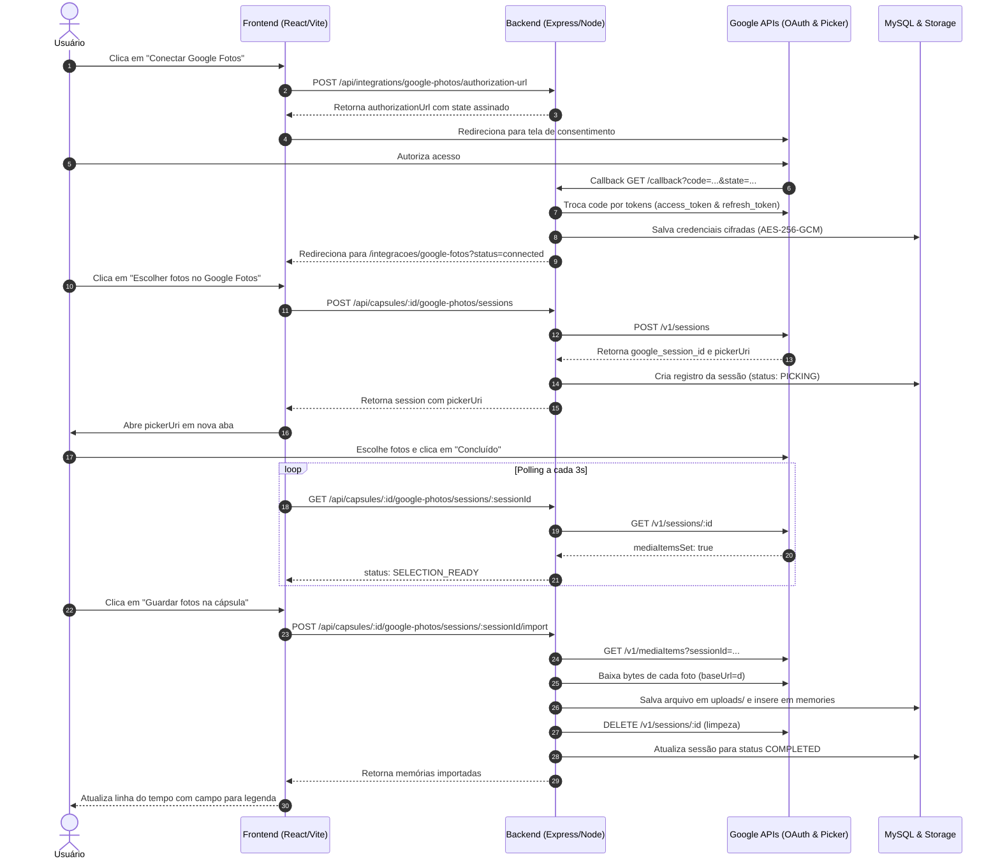

# Documentação Técnica: Integração com Google Photos Picker API no Eternity

Esta documentação detalha todo o processo implementado para integrar o Eternity com a **Google Photos Picker API**, desde as configurações de nuvem até as rotas de backend, armazenamento local e experiência de usuário no frontend.

---

## 1. Visão Geral da Arquitetura

Diferente de APIs tradicionais de biblioteca que solicitam permissão irrestrita a todas as fotos da pessoa, a **Google Photos Picker API** utiliza o modelo de *compartilhamento delimitado*:
1. O usuário autoriza a conexão OAuth 2.0 apenas com o escopo de leitura do Picker.
2. A aplicação cria uma **sessão de seleção** (*Picker Session*) e abre a interface oficial do Google Photos em uma nova aba (`pickerUri`).
3. O usuário seleciona manualmente apenas as fotos que deseja trazer para a cápsula.
4. O backend monitora o status da sessão via polling e, quando o usuário conclui (`mediaItemsSet: true`), baixa os bytes das fotos em alta resolução, grava no storage local e as adiciona na linha do tempo como memórias (`source: 'GOOGLE_PHOTOS'`).
5. A sessão no Google é finalizada e excluída (`DELETE /v1/sessions/{id}`).



---

## 2. Passo a Passo de Configuração no Google Cloud Console

Para permitir que a aplicação se comunique com o Google, os seguintes passos foram configurados no console:

1. **Criação do Projeto**:
   - Criação de um projeto no [Google Cloud Console](https://console.cloud.google.com/).

2. **Ativação da API correta**:
   - Em **APIs e Serviços > Biblioteca**, foi habilitada a **Google Photos Picker API** (identificador de serviço `photospicker.googleapis.com`).

3. **Tela de Consentimento OAuth (Google Auth Platform)**:
   - **User Type**: Externo (*External*).
   - **Nome da Aplicação**: `Eternity`.
   - **Escopo mínimo obrigatório**:
     ```text
     https://www.googleapis.com/auth/photospicker.mediaitems.readonly
     ```
   - **Usuários de Teste**: Em modo de desenvolvimento (*Testing*), o e-mail Google do usuário (`vameri@gmail.com`) foi registrado como usuário de teste para contornar o bloqueio de `access_denied (Erro 403)`.

4. **Credenciais OAuth 2.0**:
   - Criação de credencial do tipo **Aplicativo da Web** (*Web Application*).
   - **Origem JavaScript autorizada**: `http://localhost:5173`
   - **URI de redirecionamento autorizada**: `http://localhost:3333/api/integrations/google-photos/callback`
   - Geração do **Client ID** e **Client Secret**.

---

## 3. Banco de Dados

A integração utiliza duas tabelas principais no MySQL:

### 3.1. `integration_connections`
Armazena a conexão OAuth do usuário com o provedor:
- `user_id`: ID do usuário proprietário.
- `provider`: `'google-photos'`.
- `external_account_id`: Identificador da conta (ex: `'primary'`).
- `display_name`: E-mail ou nome da conta Google.
- `credentials_encrypted`: Tokens (`access_token`, `refresh_token`, `expiresAt`) cifrados com **AES-256-GCM**.
- `status`: `'ACTIVE'`, `'REVOKED'` ou `'ERROR'`.

### 3.2. `google_photos_picker_sessions`
Rastreia a sessão de seleção de fotos vinculada à cápsula:
- `google_session_id`: ID da sessão retornado pela Google Photos Picker API.
- `picker_uri`: Link do seletor aberto pelo usuário.
- `status`: `'PICKING'` -> `'SELECTION_READY'` -> `'IMPORTING'` -> `'COMPLETED'`.
- `selected_count`: Quantidade de itens escolhidos.
- `imported_count`: Quantidade de memórias criadas.
- `imported_item_ids`: Array JSON com os IDs do Google já importados (garantindo idempotência em caso de falha de rede ou retry).

---

## 4. Segurança e Criptografia (AES-256-GCM)

Para atender às boas práticas de segurança e privacidade:
1. **Chave de Criptografia**: Gerada uma chave aleatória de 32 bytes (`openssl rand -base64 32`) e configurada no `backend/.env`.
2. **Cifragem de Tokens**: Os tokens nunca são gravados em texto plano no banco de dados.
   - Algoritmo: `aes-256-gcm`.
   - Vetor de inicialização (IV): 12 bytes aleatórios por operação.
   - Tag de autenticação: 16 bytes para garantir integridade contra adulteração.
3. **Proteção Anti-CSRF no OAuth**:
   - O parâmetro `state` enviado ao Google é um token JWT assinado com HMAC contendo o `userId`, nonce e expiração de 10 minutos (`stateTtlSeconds: 600`), garantindo que o callback seja vinculado estritamente à sessão do usuário correto.

---

## 5. Implementação no Backend (Node.js / Express)

### 5.1. Serviço Central: [`backend/src/services/google-photos.service.js`](backend/src/services/google-photos.service.js)
Responsável por toda a lógica de negócio e comunicação com as APIs do Google:
- **`getConnectionStatus(userId)`**: Retorna se a conta possui conexão ativa sem vazar tokens.
- **`generateAuthorizationUrl(userId)`**: Monta a URL de consentimento com `access_type=offline`, `prompt=consent` e o `state` assinado.
- **`handleOAuthCallback({ code, state })`**: Valida o estado, faz a troca do `code` por tokens via `POST https://oauth2.googleapis.com/token`, cifra os dados e persiste na tabela `integration_connections`.
- **`getValidAccessToken(userId)`**: Recupera o token de acesso. Se estiver a menos de 2 minutos de expirar, utiliza o `refresh_token` para renovar automaticamente sem interromper o usuário.
- **`createPickerSession(userId, capsuleId)`**: Envia `POST https://photospicker.googleapis.com/v1/sessions`, registra no banco e retorna o `pickerUri`.
- **`getPickerSession(userId, capsuleId, sessionId)`**: Consulta `GET https://photospicker.googleapis.com/v1/sessions/{id}`. Quando `mediaItemsSet` se torna verdadeiro, consulta a contagem de itens e atualiza o estado para `SELECTION_READY`.
- **`importPickerSession(userId, capsuleId, sessionId)`**:
  - Inicia uma transação MySQL com `SELECT ... FOR UPDATE`.
  - Percorre os itens retornados por `GET /v1/mediaItems`.
  - Baixa os bytes originais da foto adicionando `=d` à `baseUrl` da foto.
  - Grava a imagem no disco local através de `localStorage.saveRemoteImage`.
  - Insere a memória na cápsula com `source = 'GOOGLE_PHOTOS'` e **`title = null`** (evitando nomes de arquivo automáticos como `IMG_...jpg`).
  - Executa `DELETE /v1/sessions/{id}` no Google para liberar os recursos temporários.
  - Efetua o commit da transação.

### 5.2. Controladores e Rotas:
- [`backend/src/controllers/google-photos.controller.js`](backend/src/controllers/google-photos.controller.js) e [`backend/src/routes/google-photos.routes.js`](backend/src/routes/google-photos.routes.js):
  - `GET /api/integrations/google-photos/status`
  - `POST /api/integrations/google-photos/authorization-url`
  - `GET /api/integrations/google-photos/callback`
- [`backend/src/routes/capsule.routes.js`](backend/src/routes/capsule.routes.js):
  - `POST /api/capsules/:id/google-photos/sessions`
  - `GET /api/capsules/:id/google-photos/sessions/:sessionId`
  - `POST /api/capsules/:id/google-photos/sessions/:sessionId/import`

### 5.3. Edição de Memórias:
Para permitir ao usuário dar uma legenda para a foto importada:
- Criada a rota `PATCH /api/memories/:id` em [`backend/src/routes/memory.routes.js`](backend/src/routes/memory.routes.js).
- Adicionada a função `updateMemory` em [`backend/src/controllers/memory.controller.js`](backend/src/controllers/memory.controller.js) para atualizar `title` e `content` garantindo que a cápsula não esteja selada.

---

## 6. Implementação no Frontend (React / Vite)

### 6.1. Cliente de API ([`frontend/src/lib/api.js`](frontend/src/lib/api.js))
Foram expostos os métodos:
- `getGooglePhotosStatus()`
- `getGooglePhotosAuthorizationUrl()`
- `createGooglePhotosPickerSession(capsuleId)`
- `getGooglePhotosPickerSession(capsuleId, sessionId)`
- `importGooglePhotosPickerSession(capsuleId, sessionId)`
- `updateMemory(id, payload)`

### 6.2. Card de Importação ([`frontend/src/components/GooglePhotosImport.jsx`](frontend/src/components/GooglePhotosImport.jsx))
- Verifica se a conta já está conectada.
- Permite iniciar a autenticação com redirecionamento ao Google.
- Abre o seletor com o sufixo `/autoclose` em nova aba.
- Faz polling do progresso da seleção e habilita o botão **Guardar fotos na cápsula**.

### 6.3. Tratamento de Nome de Arquivo e Legenda Editável ([`frontend/src/components/MemoryCard.jsx`](frontend/src/components/MemoryCard.jsx))
- **Filtro de Nome Técnico**: A função `isRawFileName` identifica nomes automáticos de câmeras e smartphones (ex.: `IMG_2026...jpg`, `PXL_...`, `.png`) e evita que sejam renderizados como títulos feios.
- **Botão de Inserção de Legenda**: Quando a foto não possui legenda, exibe um botão interativo:
  ```text
  ✎ Digite uma legenda para essa foto…
  ```
- **Edição Inline**: Ao clicar, um campo editável com botões **Salvar** e **Cancelar** permite digitar a legenda.
- **Persistência Imediata**: Ao salvar, a API `PATCH /api/memories/:id` é disparada e o card atualiza o texto instantaneamente sem recarregar toda a página.
- **Edição Contínua**: Se a foto já tiver legenda, exibe o texto com estilo editorial e um ícone `✎` para editar novamente quando quiser.

---

## 7. Variáveis de Ambiente Criadas no `backend/.env`

```dotenv
# Google Photos Picker
GOOGLE_PHOTOS_CLIENT_ID=553558864113-veta0pst9uks8215qb7fuvodnjrq6sgc.apps.googleusercontent.com
GOOGLE_PHOTOS_CLIENT_SECRET=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
GOOGLE_PHOTOS_REDIRECT_URI=http://localhost:3333/api/integrations/google-photos/callback
GOOGLE_PHOTOS_TOKEN_ENCRYPTION_KEY=5VA5NCZvuFACotaEN34GZOr8xSPuqhudDYrfrAe0SWA=
GOOGLE_PHOTOS_STATE_TTL_SECONDS=600
GOOGLE_PHOTOS_MAX_FILE_SIZE_MB=50
GOOGLE_PHOTOS_MAX_ITEMS_PER_SESSION=50
```

---

## 8. Login e Cadastro com o Google (Gmail)

Para manter as documentações organizadas por responsabilidade, a documentação completa, arquitetura e passo a passo de configuração do **Login e Cadastro Social via Google** foi separada no arquivo dedicado:

👉 **[DOCUMENTACAO_LOGIN_GOOGLE.md](DOCUMENTACAO_LOGIN_GOOGLE.md)**


