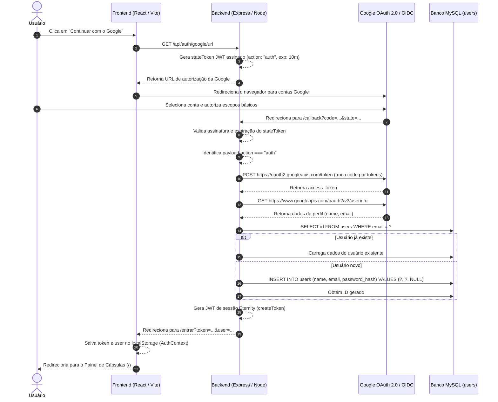

# Documentação Técnica: Login e Cadastro com Google (Gmail) no Eternity

Esta documentação detalha a implementação completa do **Login e Cadastro Social com o Google (Gmail)** na plataforma Eternity, utilizando os protocolos **OAuth 2.0** e **OpenID Connect (OIDC)**.

---

## 1. Visão Geral da Solução

O objetivo desta funcionalidade é permitir que qualquer usuário com conta Google/Gmail possa acessar ou criar sua conta no Eternity com apenas 1 clique, eliminando a necessidade de preencher formulários e decorar senhas.

### Características Principais:
1. **Fluxo Unificado (Login & Cadastro Automático)**:
   - Se o e-mail retornado pelo Google já existir no banco, o usuário é autenticado instantaneamente.
   - Se for o primeiro acesso desse e-mail, uma nova conta é criada automaticamente na tabela `users` com o nome e e-mail da conta Google, e o login é concluído imediatamente sem etapas adicionais.
2. **Reaproveitamento de Credenciais (Single Client)**:
   - Compartilha o mesmo `Client ID` e `Client Secret` configurados no Google Cloud para a integração com o Google Photos, sem necessidade de criar outro projeto ou gerar novas chaves.
3. **Multiplexador Inteligente de Callback**:
   - O mesmo endpoint de redirecionamento (`/api/integrations/google-photos/callback`) recebe tanto callbacks de importação de fotos quanto callbacks de autenticação social, diferenciando o propósito pelo `state` criptografado.

---

## 2. Diagrama de Sequência do Fluxo de Autenticação



---

## 3. Alteração no Banco de Dados (MySQL)

Para suportar contas autenticadas exclusivamente por provedores sociais, o campo de senha (`password_hash`) deve aceitar valor nulo (`NULL`), pois usuários que entram pelo Google não precisam de uma senha local.

### Comando Executado:
```sql
ALTER TABLE users MODIFY password_hash VARCHAR(255) NULL;
```

### Definição Atualizada da Tabela (`database.sql`):
```sql
CREATE TABLE IF NOT EXISTS users (
  id BIGINT UNSIGNED NOT NULL AUTO_INCREMENT,
  name VARCHAR(150) NOT NULL,
  email VARCHAR(191) NOT NULL,
  password_hash VARCHAR(255) NULL,
  created_at DATETIME NOT NULL DEFAULT CURRENT_TIMESTAMP,
  updated_at DATETIME NOT NULL DEFAULT CURRENT_TIMESTAMP ON UPDATE CURRENT_TIMESTAMP,
  PRIMARY KEY (id),
  UNIQUE KEY uq_users_email (email)
) ENGINE=InnoDB;
```

---

## 4. Implementação no Backend (Node.js & Express)

### 4.1. Geração da URL de Consentimento Google
**Arquivo**: [`backend/src/controllers/auth.controller.js`](backend/src/controllers/auth.controller.js)  
**Função**: `getGoogleAuthUrl`  
**Endpoint**: `GET /api/auth/google/url`

Gera um token JWT temporário (10 minutos) assinado com o `JWT_SECRET` da aplicação contendo `{ action: "auth", nonce: "..." }` para proteção contra ataques CSRF (Cross-Site Request Forgery).

```javascript
export const getGoogleAuthUrl = asyncHandler(async (_req, res) => {
  if (!env.googlePhotos.clientId || !env.googlePhotos.redirectUri) {
    throw new HttpError(500, "Google OAuth não está configurado no servidor.");
  }

  const stateToken = jwt.sign(
    { action: "auth", nonce: crypto.randomBytes(16).toString("hex") },
    env.jwtSecret,
    { expiresIn: 600, audience: "google-auth-state" }
  );

  const url = new URL("https://accounts.google.com/o/oauth2/v2/auth");
  url.searchParams.set("client_id", env.googlePhotos.clientId);
  url.searchParams.set("redirect_uri", env.googlePhotos.redirectUri);
  url.searchParams.set("response_type", "code");
  url.searchParams.set("scope", "openid email profile");
  url.searchParams.set("prompt", "select_account");
  url.searchParams.set("state", stateToken);

  res.json({ url: url.toString() });
});
```

### 4.2. Roteamento Inteligente no Callback
**Arquivo**: [`backend/src/controllers/google-photos.controller.js`](backend/src/controllers/google-photos.controller.js)  
**Função**: `handleGooglePhotosCallback`  
**Endpoint**: `GET /api/integrations/google-photos/callback`

Inspeciona o payload descriptografado do `state`. Se for uma autenticação, transfere a requisição para `handleGoogleAuth`; caso contrário, segue o fluxo de importação do Google Fotos.

```javascript
  // Se for autenticação de Login/Cadastro Google:
  if (statePayload?.action === "auth" || statePayload?.aud === "google-auth-state") {
    return handleGoogleAuth({ code, res });
  }

  // Se for conexão com a biblioteca do Google Fotos:
  await googlePhotosService.handleOAuthCallback({ code, state });
  return res.redirect(`${env.frontendUrl}/integracoes/google-fotos?status=connected`);
```

### 4.3. Processamento de Perfil e Sessão
**Arquivo**: [`backend/src/controllers/auth.controller.js`](backend/src/controllers/auth.controller.js)  
**Função**: `handleGoogleAuth`

1. Troca o `code` de autorização pelos tokens de acesso na Google.
2. Faz uma chamada segura ao endpoint de UserInfo do Google (`https://www.googleapis.com/oauth2/v3/userinfo`).
3. Normaliza o e-mail (`toLowerCase().trim()`).
4. Procura o usuário no banco MySQL:
   - Se já existe: reutiliza o registro existente.
   - Se não existe: executa `INSERT INTO users (name, email, password_hash) VALUES (?, ?, NULL)`.
5. Emite o token JWT de sessão padrão da Eternity (`createToken(user)`).
6. Redireciona o navegador para a tela de autenticação do frontend com os parâmetros de token:
   `${env.frontendUrl}/entrar?token=${token}&user=${JSON.stringify(user)}`.

---

## 5. Implementação no Frontend (React)

### 5.1. Métodos de API
**Arquivo**: [`frontend/src/lib/api.js`](frontend/src/lib/api.js)

```javascript
async getGoogleAuthUrl() {
  return request('/auth/google/url', { method: 'GET', token: null });
}
```

### 5.2. Suporte a Login por Token Externo
**Arquivo**: [`frontend/src/context/AuthContext.jsx`](frontend/src/context/AuthContext.jsx)

Criada a função `loginWithToken(session)` no contexto de autenticação para armazenar o token JWT e os dados do usuário no `localStorage` e atualizar o estado da aplicação:

```javascript
loginWithToken(session) {
  return completeSession(session);
}
```

### 5.3. Interface de Autenticação
**Arquivo**: [`frontend/src/pages/AuthPage.jsx`](frontend/src/pages/AuthPage.jsx)

1. **Botão Social com Ícone Oficial**:
   - Renderiza o botão estilizado com o logo da Google.
   - Texto dinâmico:
     - Aba *Entrar*: **"Continuar com o Google"**
     - Aba *Criar conta*: **"Cadastrar com o Google"**
2. **Divisor Visual**:
   - Linha suave com o texto *"ou use seu e-mail"*, separando o login social do formulário tradicional de login/senha.
3. **Captura do Callback**:
   - Ao carregar a página `/entrar`, um `useEffect` verifica se há `?token=...&user=...` na URL:
   - Converte o usuário JSON, chama `loginWithToken({ token, user })` e redireciona imediatamente para o painel principal (`/`).
   - Se houver `?error=...` na URL, exibe uma mensagem de erro clara para o usuário.

### 5.4. Estilos Customizados (Design System Vanilla CSS)
**Arquivo**: [`frontend/src/styles.css`](frontend/src/styles.css)

Classes dedicadas foram adicionadas respeitando a identidade visual acolhedora e editorial da Eternity:
- `.auth-social`: Contêiner de botões de login social.
- `.button--social`: Botão com cantos arredondados, fundo suave, borda discreta e elevação ao passar o mouse (`:hover`).
- `.google-icon`: Dimensões e posicionamento alinhados ao texto.
- `.auth-divider`: Linha divisória horizontal com texto centralizado.

---

## 6. Configurações no Google Cloud Console

Para que o login e cadastro via Gmail funcionem perfeitamente, os seguintes pontos devem estar configurados no [Google Cloud Console](https://console.cloud.google.com/):

### 6.1. Escopos da Tela de Consentimento (OAuth Consent Screen)
Adicione os seguintes escopos obrigatórios (todos classificados como não sensíveis):
- `openid` (Identificador único do usuário OpenID Connect)
- `.../auth/userinfo.email` (Endereço de e-mail do usuário)
- `.../auth/userinfo.profile` (Nome e foto de perfil)

### 6.2. URIs de Redirecionamento Autorizados
No cliente OAuth 2.0 (Tipo: Aplicação Web), a URI autorizada deve ser:
```text
http://localhost:3333/api/integrations/google-photos/callback
```
*(Em ambiente de produção, adicione também a URL correspondente do seu domínio HTTPS de produção)*.

### 6.3. Usuários de Teste (Test Users)
Enquanto o app estiver com status **"Testing"** (Em teste) no Google Cloud Console:
- Apenas e-mails explicitamente listados na aba **"Test users"** conseguirão efetuar login.
- Contas não adicionadas receberão o erro `Erro 403: access_denied`.
- Para liberar para qualquer conta Gmail sem restrição, publique o app alterando o status de publicação para **"In production"**.

---

## 7. Passo a Passo para Testar

### Cenário 1: Login / Cadastro com o Google
1. Acesse `http://localhost:5173/entrar`.
2. Clique no botão **"Continuar com o Google"**.
3. O navegador será redirecionado para a tela oficial de contas do Google.
4. Escolha sua conta Google e aprove a autorização.
5. Você será redirecionado de volta para o Eternity já autenticado no painel de cápsulas.
6. Se a conta não existia no Eternity, ela terá sido criada no banco automaticamente.

### Cenário 2: Cadastro na aba "Criar conta"
1. Acesse `http://localhost:5173/criar-conta` (ou clique na aba "Criar conta").
2. O botão exibirá **"Cadastrar com o Google"**.
3. O fluxo é idêntico e unificado: ao clicar, o sistema cria a conta e faz o login imediatamente.

### Cenário 3: Coexistência com Login por E-mail e Senha
1. Usuários que criaram conta previamente com formulário de e-mail/senha podem usar o botão do Google caso usem o mesmo endereço de e-mail da conta Google.
2. Usuários que se cadastraram via Google não possuem senha local cadastrada e sempre entram pelo botão do Google.

---

## 8. Resumo dos Arquivos Modificados / Criados

| Arquivo | Tipo de Alteração | Descrição |
| :--- | :--- | :--- |
| `database.sql` | Modificado | Permitiu `password_hash VARCHAR(255) NULL` na tabela `users` |
| `backend/src/controllers/auth.controller.js` | Modificado | Adicionou `getGoogleAuthUrl` e `handleGoogleAuth` |
| `backend/src/routes/auth.routes.js` | Modificado | Registrou a rota `GET /api/auth/google/url` |
| `backend/src/controllers/google-photos.controller.js` | Modificado | Adicionou despacho condicional no callback para ação de autenticação |
| `frontend/src/lib/api.js` | Modificado | Adicionou `api.getGoogleAuthUrl()` |
| `frontend/src/context/AuthContext.jsx` | Modificado | Adicionou método `loginWithToken(session)` |
| `frontend/src/pages/AuthPage.jsx` | Modificado | Adicionou botão do Google, divisor e processamento do token na URL |
| `frontend/src/styles.css` | Modificado | Adicionou estilos para `.button--social`, `.auth-divider` e `.google-icon` |
